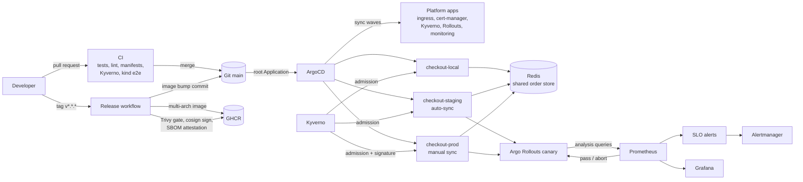

# Meridian

Meridian is a production-shaped GitOps delivery platform built around a hardened Go checkout API. It demonstrates the full path from a pull request to a signed, progressively delivered production rollout: Terraform bootstraps a local Kubernetes cluster and ArgoCD, ArgoCD reconciles every platform component and environment from Git, and Argo Rollouts gates production on Prometheus SLO metrics.

The application is deliberately small so the platform is the subject. Every layer is real: there are no mocked pipelines, no hand-installed add-ons after bootstrap, and no `kubectl apply` as the deployment mechanism.

## What is demonstrated

| Area | Implementation |
| --- | --- |
| Application | Go 1.26 stdlib HTTP API, structured `slog` logs, Prometheus metrics, idempotent writes, graceful drain |
| Packaging | Distroless nonroot image, multi-arch build, Helm chart with JSON-schema validation and three overlays |
| Cluster bootstrap | Terraform (kind provider + Helm provider) creates the cluster, installs ArgoCD, registers the AppProject and root Application |
| GitOps | App-of-apps with sync waves, ApplicationSet for local/staging, a manually synced production Application |
| Progressive delivery | Argo Rollouts canary via ingress-nginx traffic splitting, Prometheus AnalysisTemplates for success rate and p95 latency |
| Reliability | Multi-window multi-burn-rate SLO alerts, error-budget policy, Grafana dashboard, PDB, HPA, topology spread |
| Policy as code | Kyverno CEL `ValidatingPolicy`, `MutatingPolicy`, `ImageValidatingPolicy`; unit tested with the Kyverno CLI |
| Supply chain | Multi-arch GHCR images, Trivy gate, keyless cosign signature, SPDX SBOM attestation, Kyverno verification in production |
| Delivery automation | PR CI, tag release workflow, automatic staging image bump, production promotion pull request |
| Operations | SLO/runbook docs, architecture decision records, smoke and k6 load tests, one-command bootstrap |

## Architecture



### Bootstrap versus reconciliation

Terraform owns only the control plane boundary: the kind cluster, the ArgoCD Helm release, the `grafana-admin` Secret, the AppProject and the root Application. Everything below the root Application is reconciled from Git. The root Application points at `deploy/gitops/app-of-apps`, whose sync waves install namespaces, cert-manager, ingress-nginx, Kyverno, Argo Rollouts, kube-prometheus-stack and the policies before the checkout environments are created.

Production is intentionally not auto-synced. Merging a promotion PR changes Git; a human clicks **Sync** in ArgoCD, and the canary is then gated by Prometheus analysis.

## Repository layout

```text
.
├── services/checkout-api/          # Go API, unit tests, Dockerfile, lint config
├── deploy/charts/checkout-api/     # Helm chart, values schema, environment overlays
├── deploy/gitops/                  # AppProject, root app, app-of-apps, ApplicationSet
├── deploy/platform/                # Pinned values for platform Helm charts
├── policies/                       # Kyverno CEL policies and CLI tests
├── infra/terraform/                # kind cluster + ArgoCD bootstrap
├── scripts/                        # bootstrap, smoke, load, image bump, org rewrite
├── docs/                           # SLOs, runbook, ADRs
└── .github/workflows/              # CI, release, CodeQL, Terraform, prod promotion
```

## Quickstart

### Prerequisites

- Docker Desktop or OrbStack with a running daemon
- Terraform >= 1.9, kubectl, Helm >= 3.19, jq, git
- Go 1.26 and golangci-lint v2 for local development
- Optional: k6, Kyverno CLI v1.20, cosign

On macOS, `localtest.me` already resolves to `127.0.0.1`; no `/etc/hosts` edits are required.

### 1. Fork and parameterize

Fork the repository, then replace the GitHub owner and GHCR path used by ArgoCD, Kyverno, CI and image references:

```bash
git clone https://github.com/<your-org>/<repo>.git
cd <repo>
./scripts/set-github-org.sh <your-org> <repo>
git add -A && git commit -m "chore: point manifests at fork"
git push origin main
```

The GitHub repository must be reachable from the kind cluster over HTTPS. A private repository needs an ArgoCD repository credential; the default quickstart assumes public.

### 2. Bootstrap

```bash
make up
```

This runs the two-stage Terraform apply (cluster first, then ArgoCD and the root app), waits for ArgoCD, then waits until every Application is `Synced` and `Healthy` (15 minute budget). The first sync pulls several upstream charts and can take a few minutes.

| Endpoint | URL | Credentials |
| --- | --- | --- |
| Local environment | https://checkout.localtest.me:8443 | none (self-signed) |
| Staging | https://checkout-staging.localtest.me:8443 | none (self-signed) |
| Production | https://checkout-prod.localtest.me:8443 | none (self-signed) |
| Grafana | https://grafana.localtest.me:8443 | `terraform -chdir=infra/terraform output -raw grafana_admin_password` |
| ArgoCD | `make port-forward` then http://localhost:8081 | admin / `terraform -chdir=infra/terraform output -raw argocd_admin_password_command` |

### 3. Verify

```bash
make smoke        # API contract, idempotency, validation, listing
make load         # k6 ramping load with p95 < 300 ms and < 1% errors
make port-forward # ArgoCD, Grafana, Prometheus
```

`make down` destroys the kind cluster. Terraform state and the generated kubeconfig are ignored by Git.

## API

| Method | Path | Behavior |
| --- | --- | --- |
| `GET` | `/healthz` | liveness; always 200 while the process is alive |
| `GET` | `/readyz` | readiness; 503 while draining |
| `GET` | `/drainz` | flips readiness to draining (called by the preStop hook) |
| `GET` | `/metrics` | Prometheus/OpenMetrics exposition |
| `POST` | `/v1/orders` | validates an order; requires `Idempotency-Key` for replay protection |
| `GET` | `/v1/orders/{id}` | fetch one order |
| `GET` | `/v1/orders?customerId=...&limit=...` | list a customer's orders, newest first |

```bash
curl -sSk https://checkout.localtest.me:8443/v1/orders \
  -H 'Content-Type: application/json' \
  -H 'Idempotency-Key: demo-1' \
  -d '{"customerId":"cust_demo","items":[{"sku":"sku_1","quantity":2,"unitPriceCents":1500}]}'
```

Orders and idempotency records are stored in a shared Redis deployment that the chart creates per environment, so replays and reads are consistent across replicas. Running the binary without `REDIS_ADDR` falls back to the in-memory store used by unit tests. Redis here uses an emptyDir and no auth for demo simplicity: state survives app pod churn but not Redis/node loss, and production should use a managed, authenticated, persistent instance.

The bundled ingress uses a self-signed issuer, so `curl -k` and the smoke script's default TLS skip are expected; set `SMOKE_VERIFY_TLS=1` once you install a trusted issuer.

Error behavior is explicit: `400 invalid_json`, `413 body_too_large`, `415 unsupported_media_type`, `422 validation_error`, `409 idempotency_conflict`, `404 not_found`, `405 method_not_allowed`, `500 internal_error`. Every response carries an `X-Request-Id`.

## Delivery flow

1. **Pull request** — CI runs `go test -race`, golangci-lint, Helm lint/render, kubeconform, Kyverno policy tests, Terraform validation, actionlint, and a kind e2e smoke test against the built image.
2. **Release tag** — pushing `v1.2.3` builds `linux/amd64` and `linux/arm64` images, scans them with Trivy, signs the digest keylessly with cosign, attests an SPDX SBOM, verifies its own signature, and commits the new tag to `environments/staging.yaml` with `[skip ci]`.
3. **Staging** — ArgoCD auto-syncs the bump and Argo Rollouts runs a canary. Prometheus success-rate and p95 analysis decide whether to continue or abort.
4. **Production promotion** — the `promote-prod` workflow opens a PR that changes only `environments/prod.yaml`. Merging it is authorization, not deployment: `checkout-api-prod` is manual-sync. A human syncs, the canary runs again under stricter thresholds (99.5% success rate), and Kyverno verifies the image signature and SBOM attestation before the pod is admitted.

## Reliability

The availability SLO is **99.5%** of checkout requests over a rolling 30-day window. The latency SLO is **p95 < 300 ms**. Prometheus rules implement multi-window multi-burn-rate alerts at 14.4x, 6x and 1x budget consumption. The production canary requires at least 99.5% success and p95 below 300 ms; staging uses the chart default (99%).

See [docs/slo.md](docs/slo.md) for SLI definitions, PromQL, error-budget math and the release-freeze policy, and [docs/runbook.md](docs/runbook.md) for alert-by-alert response.

## Security posture

- Pod Security Standards `restricted` enforced on all checkout namespaces; Kyverno policies add explicit, reportable controls for probes, resources, ownership labels, mutable tags, container security context and allowed registries.
- Production images must be signed by the release workflow's GitHub OIDC identity, have a Rekor entry, and carry a cosign-verified SPDX attestation. The ImageValidatingPolicy pins the verified digest at admission.
- Default-deny NetworkPolicies allow ingress only from the ingress controller and monitoring, plus DNS egress.
- Runtime hardening: nonroot UID/GID 65532, read-only root filesystem, all capabilities dropped, seccomp `RuntimeDefault`, no service-account token mount, 30s graceful drain.
- CI runs CodeQL with security-extended queries and uploads Trivy SARIF to code scanning.

## Design decisions and honest limits

- **kind + Terraform** keeps the demo runnable on a laptop at the cost of a two-stage apply. A real installation swaps the kind provider for EKS/GKE modules; ArgoCD and everything below it stay unchanged. See [ADR 0003](docs/adr/0003-kind-terraform-bootstrap.md).
- **Redis-backed order store** makes idempotency and reads correct across replicas; a Lua script writes the idempotency record, order and customer index atomically. The in-memory implementation remains for dependency-free local runs. Redis is intentionally a single demo instance with emptyDir storage rather than a production HA datastore.
- **Keyless signatures** require the release workflow to run in GitHub Actions with `id-token: write`. The Kyverno subject and image glob are repo-specific and are rewritten by `scripts/set-github-org.sh`.
- **Policy failure modes**: the image policy fails closed in production. A registry outage that prevents signature verification blocks admission; this is deliberate for the production trust boundary.
- **Alerting** is wired to a no-op Alertmanager receiver by default. Add PagerDuty/Slack routing in `deploy/platform/kube-prometheus-stack/values.yaml` before calling this production-ready.
- **Secrets**: the Grafana credential is generated by Terraform for local use. A real deployment should use External Secrets or Sealed Secrets and should not keep the Grafana admin password in Terraform state.

## Verification

Static and local checks run in this repository:

| Check | Command | Result |
| --- | --- | --- |
| Go unit tests | `CGO_ENABLED=0 go test ./...` | pass |
| Go race tests | `go test -race ./...` | pass (macOS requires the SDKROOT workaround noted below) |
| Lint | `golangci-lint run ./...` | 0 issues |
| Chart | `helm lint --strict`, render local/staging/prod | pass |
| Schemas | `kubeconform -strict` with CRD catalog | 73/73 resources valid |
| Policies | `kyverno test policies/tests` and mutation test | 24/24 and 1/1 pass; applied to a live Kyverno v1.20 cluster, mutation and audit reports observed |
| Terraform | `terraform fmt -check`, `validate`, live `apply` | pass; kind + ArgoCD bootstrapped, all ArgoCD pods healthy |
| Workflows | `actionlint` | pass |
| API smoke | `scripts/smoke.sh` against the built image and live ingress | pass; 5 consecutive runs against a 2-replica staging Rollout with shared Redis |
| Redis store | `STORE_TEST_REDIS_ADDR` integration tests against the live pod | 2/2 pass (replay, conflict, get, sorted-set list) |
| Load | `k6 run scripts/load-test.js` | 1725 iterations, 5175 requests, 8625/8625 checks, 0 failed, p95 1.99 ms, p99 2.64 ms |
| Image scan | `trivy image --severity HIGH,CRITICAL --ignore-unfixed` | 0 vulnerabilities |

The macOS 27 SDK in this workspace breaks cgo linking (`tapi error: malformed file`). Unit tests therefore use `CGO_ENABLED=0`; race tests use `SDKROOT=/Applications/Xcode.app/Contents/Developer/Platforms/MacOSX.platform/Developer/SDKs/MacOSX26.5.sdk`. This is an environment quirk, not a repository issue.

The Terraform bootstrap, ingress-nginx, cert-manager, Argo Rollouts, Kyverno and both chart overlays were exercised on a real kind cluster. A full ArgoCD reconciliation requires a reachable Git remote; the root Application is created but cannot sync while the repository still points at the `your-org/meridian` placeholder. The same manifests are ready for that path once `scripts/set-github-org.sh` rewrites the remote and the repository is pushed. Monitoring/Grafana and the canary AnalysisRun were not run live because the verification cluster omitted kube-prometheus-stack.

One live integration finding is encoded in the manifests: the rollouts controller owns `.spec.selector` on the stable and canary Services (it injects `rollouts-pod-template-hash`). The ArgoCD Applications ignore `.spec.selector` for those Services, and a direct `helm upgrade` of a Rollout release requires `--force-conflicts` because server-side apply sees the controller as the field owner. See [ADR 0002](docs/adr/0002-progressive-delivery.md).

## Documentation

- [SLOs and error budgets](docs/slo.md)
- [Operations runbook](docs/runbook.md)
- [ADR 0001: GitOps with ArgoCD](docs/adr/0001-gitops-argocd.md)
- [ADR 0002: Progressive delivery with Argo Rollouts](docs/adr/0002-progressive-delivery.md)
- [ADR 0003: kind and Terraform bootstrap](docs/adr/0003-kind-terraform-bootstrap.md)
- [ADR 0004: Kyverno CEL policies](docs/adr/0004-kyverno-cel-policies.md)
- [ADR 0005: Shared Redis order store](docs/adr/0005-redis-order-store.md)

## License

MIT. See [LICENSE](LICENSE).
