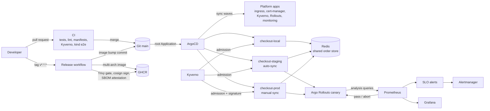

# Meridian

**A production-shaped GitOps delivery platform, built end to end.**

[](https://github.com/Stas5252s/meridian/actions/workflows/ci.yml)
[](https://github.com/Stas5252s/meridian/actions/workflows/codeql.yml)
[](services/checkout-api)
[](deploy/gitops)
[](deploy/gitops)
[](policies)
[](LICENSE)

Meridian is not a Kubernetes tutorial. It is a small but complete delivery platform: a hardened Go service, a Helm chart with real SLOs and progressive delivery, an ArgoCD app-of-apps tree, Kyverno admission policy, a signed supply chain, and the automation that moves an image from a Git tag to a canary in staging and a reviewed promotion in production.

The application is deliberately small. The platform is the point.

There is no `kubectl apply` deployment path, no hand-installed add-on after bootstrap, and no mocked pipeline. Terraform owns only the cluster and ArgoCD control plane; everything below ArgoCD is reconciled from Git.

## Contents

- [Architecture](#architecture)
- [What is inside](#what-is-inside)
- [Verification](#verification)
- [Quickstart](#quickstart)
- [API](#api)
- [Delivery pipeline](#delivery-pipeline)
- [GitOps layout](#gitops-layout)
- [Reliability](#reliability)
- [Security](#security)
- [Make targets](#make-targets)
- [Configuration](#configuration)
- [Honest limits](#honest-limits)
- [Documentation](#documentation)

## Architecture



### Bootstrap versus reconciliation

Terraform creates the kind cluster, installs ArgoCD, and registers the AppProject plus the root Application. That is the entire imperative surface.

The root Application points at `deploy/gitops/app-of-apps` and reconciles, in order:

| Wave | Applications | Why |
| --- | --- | --- |
| `-30` | Namespaces | Pod Security labels must exist before workloads |
| `-25` | kube-prometheus-stack | Must precede charts that emit ServiceMonitor CRs |
| `-20` | cert-manager | CRDs and webhook before issuers and Ingresses |
| `-10` | ingress-nginx, Kyverno, Argo Rollouts | Traffic, policy and rollout controllers |
| `-5` | cert-manager configuration, Kyverno policies | ClusterIssuer, policies, app-of-apps dependencies |
| `0` | checkout local, staging, production | Workloads last |

Production is intentionally manual-sync. Merging a promotion pull request changes Git; a human reviews the diff and clicks **Sync**. The canary is then gated by Prometheus analysis.

## What is inside

| Area | Implementation |
| --- | --- |
| Application | Go 1.26 stdlib HTTP API, structured `slog` logs, Prometheus metrics, idempotent writes, graceful drain |
| Packaging | Distroless nonroot image, multi-arch build, Helm chart with JSON-schema validation and three overlays |
| Cluster bootstrap | Terraform (kind, Helm, Kubernetes and kubectl providers) creates the cluster, installs ArgoCD, registers the AppProject and root Application |
| GitOps | App-of-apps with ordered sync waves, ApplicationSet for local and staging, manual-sync production |
| Progressive delivery | Argo Rollouts canary through ingress-nginx, Prometheus AnalysisTemplates for success rate and p95 latency |
| Reliability | Multi-window multi-burn-rate SLO alerts, error-budget policy, Grafana dashboard, PDB, HPA, topology spread |
| Policy as code | Kyverno CEL `ValidatingPolicy`, `MutatingPolicy` and `ImageValidatingPolicy`, unit tested with the Kyverno CLI |
| Supply chain | Multi-arch GHCR images, Trivy gate, keyless cosign signature, SPDX SBOM attestation, Kyverno verification in production |
| Delivery automation | PR CI, tag release workflow, automatic staging image bump, production promotion pull request |
| Operations | SLO and runbook docs, ADRs, smoke and k6 load tests, one-command bootstrap |

## Verification

The platform was exercised on a real two-node kind cluster running Kubernetes 1.34.

### Live checks

| Check | Result |
| --- | --- |
| Terraform bootstrap | kind cluster, ArgoCD and the root Application created; ArgoCD control plane healthy |
| Platform components | ingress-nginx, cert-manager, Argo Rollouts and Kyverno v1.20 installed and healthy |
| Workloads | local Deployment and a 2-replica staging Rollout, both backed by Redis |
| API smoke | pass; 5 consecutive runs against staging, no idempotency failures across replicas |
| Redis integration | 2/2 tests against the live pod: replay, conflict, get and sorted-set listing |
| Kyverno at runtime | 8 policies `READY`; mutation added the environment label to a live pod; policy reports populated |
| Load | k6: 1725 iterations, 5175 requests, 8625/8625 checks, 0 failed, p95 1.99 ms, p99 2.64 ms |
| Image scan | Trivy `HIGH,CRITICAL --ignore-unfixed`: 0 vulnerabilities |

### Static and CI-equivalent checks

| Check | Result |
| --- | --- |
| Go tests | `CGO_ENABLED=0 go test ./...` pass; race detector pass on Linux CI |
| Lint | `golangci-lint run ./...`: 0 issues |
| Chart | `helm lint --strict` and render for local, staging and production |
| Schemas | `kubeconform -strict` with the Datree CRD catalog: 73/73 resources valid |
| Policies | `kyverno test policies/tests` 24/24 and mutation test 1/1 |
| Terraform | `terraform fmt -check` and `validate` pass |
| Workflows | `actionlint` pass |

The numbers above are from the reference environment. The GitHub-hosted workflows are validated statically with `actionlint`; their first real run happens on the first push. Grafana, alert delivery and the canary AnalysisRun were not executed live because the verification cluster omitted kube-prometheus-stack.

## Quickstart

### Prerequisites

- Docker Desktop or OrbStack with at least 8 GB allocated and a running daemon
- Terraform >= 1.9, kubectl, Helm >= 3.19, jq, git
- Optional for the full local check suite: Go 1.26, golangci-lint v2, Kyverno CLI v1.20, k6

On macOS, `localtest.me` resolves to `127.0.0.1`; no `/etc/hosts` edits are required.

### 1. Clone the repository

```bash
git clone https://github.com/Stas5252s/meridian.git
cd meridian
```

The manifests are already parameterized for this repository. If you fork under a different owner, rewrite the ArgoCD repo URLs, GHCR image path, Kyverno registry glob and cosign OIDC subject, then commit:

```bash
./scripts/set-github-org.sh <owner> meridian
git add -A
git commit -m "chore: point manifests at <owner>/meridian"
git push origin main
```

The repository must be reachable from the kind cluster over HTTPS. A public repository is the simplest option; a private one needs an ArgoCD repository credential.

### 2. Publish the first image

Staging and production pull images from GHCR, and Kyverno verifies their signatures. Publish `v0.1.0` before bootstrapping:

```bash
git tag v0.1.0
git push origin v0.1.0
```

The release workflow builds `linux/amd64` and `linux/arm64`, scans, signs, attests an SBOM, and commits the new tag to `environments/staging.yaml`.

If the resulting GHCR package is private, change it to public under **Package settings → Danger zone → Change package visibility**, or configure an image pull secret. Public is required for anonymous pulls by kind and for Kyverno signature verification without registry credentials.

### 3. Bootstrap

```bash
make up
```

This runs the two-stage Terraform apply, builds `checkout-api:dev` and imports it into the kind node, installs ArgoCD and the root Application, then waits up to 15 minutes for all auto-synced Applications to become `Synced` and `Healthy`. Production is manual-sync and is intentionally excluded from that wait.

| Endpoint | URL | Credentials |
| --- | --- | --- |
| Local | https://checkout.localtest.me:8443 | none (self-signed) |
| Staging | https://checkout-staging.localtest.me:8443 | none (self-signed) |
| Production | https://checkout-prod.localtest.me:8443 | none (self-signed), manual sync |
| Grafana | https://grafana.localtest.me:8443 | `terraform -chdir=infra/terraform output -raw grafana_admin_password` |
| ArgoCD | `make port-forward` then http://localhost:8081 | admin / `kubectl -n argocd get secret argocd-initial-admin-secret -o jsonpath='{.data.password}' \| base64 -d` |

### 4. Verify

```bash
make smoke        # API contract, idempotency, validation, listing
make load         # k6 ramping load with p95 < 300 ms and < 1% errors
make port-forward # ArgoCD, Grafana, Prometheus
```

`make down` destroys the kind cluster. Terraform state and the generated kubeconfig are ignored by Git.

## API

| Method | Path | Behavior |
| --- | --- | --- |
| `GET` | `/healthz` | liveness; always 200 while the process is alive |
| `GET` | `/readyz` | readiness; 503 while draining |
| `GET` | `/drainz` | flips readiness to draining (called by the preStop hook) |
| `GET` | `/metrics` | Prometheus/OpenMetrics exposition |
| `POST` | `/v1/orders` | validates an order; requires `Idempotency-Key` for replay protection |
| `GET` | `/v1/orders/{id}` | fetch one order |
| `GET` | `/v1/orders?customerId=...&limit=...` | list a customer's orders, newest first |

```bash
curl -sSk https://checkout.localtest.me:8443/v1/orders \
  -H 'Content-Type: application/json' \
  -H 'Idempotency-Key: demo-1' \
  -d '{"customerId":"cust_demo","items":[{"sku":"sku_1","quantity":2,"unitPriceCents":1500}]}'
```

Orders and idempotency records live in a shared Redis deployment created by the chart, so replays and reads stay consistent across replicas. A Lua script writes the idempotency record, order and customer index atomically. Running the binary without `REDIS_ADDR` falls back to the in-memory store used by unit tests.

Error behavior is explicit: `400 invalid_json`, `413 body_too_large`, `415 unsupported_media_type`, `422 validation_error`, `409 idempotency_conflict`, `404 not_found`, `405 method_not_allowed`, `500 internal_error`. Every response carries an `X-Request-Id`.

The bundled ingress uses a self-signed issuer, so `curl -k` and the smoke script's default TLS skip are expected; set `SMOKE_VERIFY_TLS=1` once you install a trusted issuer.

## Delivery pipeline

1. **Pull request.** CI runs `go test -race`, golangci-lint, Helm lint and render, kubeconform, Kyverno policy tests, Terraform validation, actionlint, CodeQL, and a kind end-to-end smoke test against the built image.
2. **Release tag.** Pushing `v1.2.3` builds multi-arch images, fails on HIGH or CRITICAL vulnerabilities, signs the digest keylessly with cosign, attests an SPDX SBOM, verifies its own signature, and commits the new tag to the staging overlay with `[skip ci]`.
3. **Staging.** ArgoCD auto-syncs the bump and Argo Rollouts runs a canary: 20% for 2 minutes, a Prometheus analysis, 50% for 2 minutes, then 100%. A failed analysis aborts and the stable Service keeps serving.
4. **Production promotion.** The promotion workflow opens a pull request that changes only the production overlay. Merging it is authorization, not deployment: `checkout-api-prod` is manual-sync. A human syncs, and the canary runs again under stricter thresholds while Kyverno verifies the image signature and SBOM attestation at admission.

## GitOps layout

```text
.
├── services/checkout-api/          # Go API, tests, Dockerfile, lint config
├── deploy/charts/checkout-api/     # Helm chart, values schema, environment overlays
├── deploy/gitops/                  # AppProject, root app, app-of-apps, ApplicationSet
├── deploy/platform/                # Pinned values for platform Helm charts
├── policies/                       # Kyverno CEL policies and CLI tests
├── infra/terraform/                # kind cluster and ArgoCD bootstrap
├── scripts/                        # bootstrap, smoke, load, image bump, org rewrite
├── docs/                           # SLOs, runbook, ADRs
└── .github/workflows/              # CI, release, promotion, CodeQL, Terraform
```

The chart renders either a Deployment (local) or a Rollout (staging and production), and creates the stable and canary Services, ingress, HPA, PDB, NetworkPolicies, ServiceMonitor, alerting rules, dashboard and Redis instance from one set of values.

Argo Rollouts owns `.spec.selector` on the stable and canary Services because it injects `rollouts-pod-template-hash`. The Applications therefore ignore that field; without the rule, ArgoCD and the rollout controller fight over it.

## Reliability

The availability SLO is **99.5%** of checkout requests over a rolling 30-day window. The latency SLO is **p95 < 300 ms**. Prometheus rules implement multi-window multi-burn-rate alerts at 14.4x, 6x and 1x budget consumption. The production canary requires at least 99.5% success and p95 below 300 ms; staging uses 99%.

See [docs/slo.md](docs/slo.md) for SLI definitions, PromQL and error-budget math, and [docs/runbook.md](docs/runbook.md) for alert-by-alert response.

## Security

- Pod Security Standards `restricted` on every checkout namespace, with Kyverno policies for probes, resources, ownership labels, mutable tags, container security context and allowed registries.
- Production images must be signed by the release workflow's GitHub OIDC identity, have a Rekor entry, and carry a cosign-verified SPDX attestation. The `ImageValidatingPolicy` pins the verified digest at admission.
- Default-deny NetworkPolicies allow ingress only from the ingress controller and monitoring, plus DNS and Redis egress.
- Runtime hardening: nonroot UID/GID 65532, read-only root filesystem, all capabilities dropped, seccomp `RuntimeDefault`, no service-account token mount, 30-second graceful drain.
- CI runs CodeQL with security-extended queries and uploads Trivy SARIF to code scanning.

## Make targets

| Target | Purpose |
| --- | --- |
| `make ci` | tests, lint, Helm, policy and Terraform checks |
| `make image` | build `checkout-api:dev` and import it into the kind node |
| `make up` / `make down` | create or destroy the local platform |
| `make smoke` | API contract and idempotency smoke test |
| `make load` | k6 load test against staging |
| `make port-forward` | ArgoCD, Grafana and Prometheus |
| `make helm-lint` / `make render` | chart validation and staging render |
| `make policies` | Kyverno CLI policy tests |
| `make image-bump-staging TAG=v0.2.0` | manual staging image bump |

## Configuration

The chart is driven by [values.yaml](deploy/charts/checkout-api/values.yaml) and validated by [values.schema.json](deploy/charts/checkout-api/values.schema.json). Environment overlays live in [environments](deploy/charts/checkout-api/environments).

| Value | Purpose |
| --- | --- |
| `replicaCount` | base replicas; HPA adjusts within `minReplicas`/`maxReplicas` |
| `rollout.enabled` | Deployment for local, Rollout for staging and production |
| `rollout.analysis.successRateThreshold` | canary gate; 0.99 staging, 0.995 production |
| `redis.enabled` | shared order store; disable only for single-replica experiments |
| `ingress.host` / `ingress.tls` | per-environment host and self-signed certificate |
| `networkPolicy`, `podDisruptionBudget`, `serviceMonitor` | security and observability wiring per environment |

## Honest limits

- **Full ArgoCD reconciliation requires a reachable Git remote.** The root Application is created by Terraform; it converges once the repository exists and the URLs are rewritten.
- **Monitoring is not exercised live.** kube-prometheus-stack, the Grafana dashboard, alert delivery and the canary AnalysisRun are validated statically but were omitted from the laptop verification cluster.
- **Redis is demo-grade.** A single instance with `emptyDir`, no auth and no persistence. State survives app pod churn, not Redis or node loss. Production should use a managed, authenticated, persistent datastore.
- **Production was not installed on the verification cluster.** The overlay and canary thresholds are validated, but the manual-sync production path is intentionally a human action.
- **The GitHub workflows are validated with actionlint, not executed locally.** Their first real run is on push; GitHub-hosted runners are the environment they target.
- **Alerting is a no-op by default.** Add PagerDuty or Slack routing before operating this as a real service.
- **The Grafana credential is generated by Terraform for local use.** A real deployment should use External Secrets or Sealed Secrets and keep credentials out of state.

## Documentation

- [SLOs and error budgets](docs/slo.md)
- [Operations runbook](docs/runbook.md)
- [ADR 0001: GitOps with ArgoCD](docs/adr/0001-gitops-argocd.md)
- [ADR 0002: Progressive delivery with Argo Rollouts](docs/adr/0002-progressive-delivery.md)
- [ADR 0003: kind and Terraform bootstrap](docs/adr/0003-kind-terraform-bootstrap.md)
- [ADR 0004: Kyverno CEL policies](docs/adr/0004-kyverno-cel-policies.md)
- [ADR 0005: Shared Redis order store](docs/adr/0005-redis-order-store.md)

## License

MIT. See [LICENSE](LICENSE).
